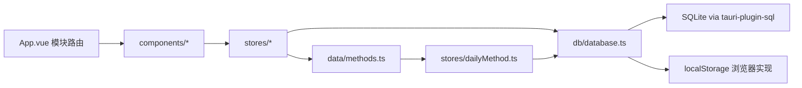
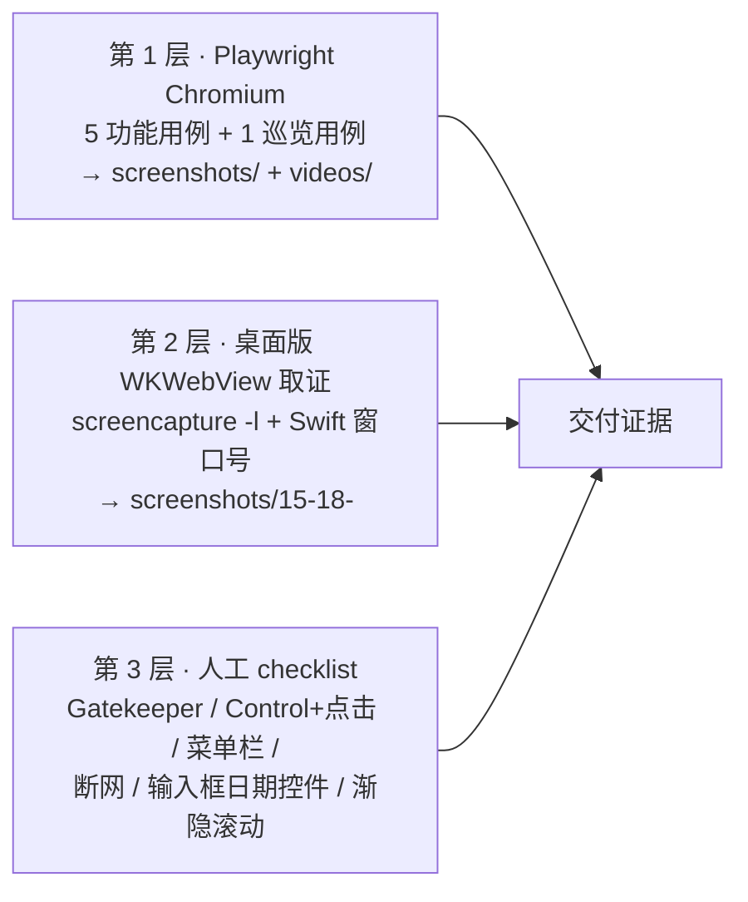

# 技术设计与实施规划 · 日程待办 macOS 版（ZACHTD-2）

| 项 | 内容 |
| --- | --- |
| 文档编号 | DESIGN-ZACHTD-2-macos |
| 关联 Issue | ZACHTD-2《规划 macOS 版「日程待办」App 开发（Tauri 2 + Vue 3，废弃原有代码，暂不执行）》 |
| 上游输入 | `docs/requirements/ZACHTD-2-macos-prd.md`（PRD v1.0）、四份 Windows 基线材料（SPEC / PLAYBOOK / AGENTS / README）、`methods.ts` 数据资产（issue 附件 `01a192dc-26c1-7bc6-aea5-6cbcaee076cd`）、裁定 CFL-07 |
| 版本 | v1.0（规划稿） |
| 作者 | @资深全栈开发专家 |
| 日期 | 2026-11-01 |
| 文档性质 | **只出规划**：不含实现代码、不初始化工程、不执行任何 git 操作、不设 deploy 目标 |

---

## 0. 本设计的输入、边界与待确认项

### 0.1 边界声明

本轮交付物只有一份设计文档。以下动作**本轮一律不做**，由执行阶段的 T- 任务承担：

- 不写实现代码、不建 `src/` 业务文件、不动 `package.json` 依赖；
- 不初始化 Tauri 工程、不生成图标、不跑 `npm install` / `npm run build` / `npm run tauri build`；
- 不做任何 git 操作（不建分支、不 commit、不 push）；执行阶段的分支名沿用 Leader 预声明的 `release/ZACHTD-2-macos-port`；
- 不设 deploy 目标、不做签名与公证。

### 0.2 事实更正（本设计实测，与材料或口头结论不一致处）

| 项 | 材料 / 口头结论 | 本机实测 | 处置 |
| --- | --- | --- | --- |
| `notarytool` 可用性 | 「notarytool 需要完整 Xcode，得先装」 | macOS 14.1 的 **CommandLineTools 内已含** `notarytool`（`/Library/Developer/CommandLineTools/usr/bin/notarytool`）与 **Swift 5.10**；缺的是 `xcodebuild`（需完整 Xcode） | OP-05 本期不签不公证，结论不变；但**将来若补公证，阻塞点是 Apple Developer 账号与 Developer ID 证书，不是 Xcode**。见 §3 ADP-13 |
| `steps` 实际分布 | CFL-07 写「断言 ≥ 2 条；实际分布 2–7」 | 用 Node 22 type-stripping 求值 `METHODS`：**steps 计数分布 = 3→6 条、4→55 条、5→3 条、7→1 条**，即**观测区间 3–7，无 2 条条目** | 断言口径按 CFL-07 保持「≥ 2 条」（该断言对真实数据成立，且为上界松弛的安全断言）；但「实际分布 2–7」的**表述**不准确，建议 PM/Tester 改写为「断言 ≥ 2 条；真实数据观测分布 3–7（3×6 / 4×55 / 5×3 / 7×1）」。见 §6.3 与 §9 |
| 最低 macOS 版本 | PRD OP-04 默认写 11.0 | G0 人类回复「全部按默认」时 Leader 明确降级为「目标 12+，仅 14.1 实测」 | 本设计取 **`minimumSystemVersion: "12.0"`**，AC-39/AC-40 只在 14.1 上实测并如实声明 |

### 0.3 待确认项（不阻塞本设计，但需在执行阶段前拍板）

| 编号 | 问题 | 本设计的默认处置 | 需要谁拍板 |
| --- | --- | --- | --- |
| Q-01 | macOS 全局菜单栏是 Tauri 默认英文（`Edit / View / Window / Help`），而 BR-22 的文案白名单**未包含菜单栏** | **接受默认英文菜单**，并在交付说明中写明「应用内界面全中文，系统菜单栏为框架默认英文」。若要求全中文菜单 → 需新增 FR 与 AC，超出本期范围 | Leader / 产品 |
| Q-02 | 是否引入单元测试框架（vitest） | **不引入**。沿用基线的 `.mjs` 校验脚本传统（`check-cases.mjs` / `check-permutation.mjs` / `verify-fix.mjs`），零新增依赖，与 BR-15「技术克制」一致 | Leader |
| Q-03 | macOS 图标源图（1024×1024 PNG）由谁产出 | 视为**设计交付物**，由设计侧产出后用 `npx tauri icon <png>` 生成全套（含 `.icns`）。若本期不产出，则沿用脚手架默认 Tauri 图标——**该结果不满足产品交付标准**，需在验收说明中显式标注为未完成项 | 设计 / Leader |
| Q-04 | `bundle.category` 取值 | 沿用脚手架现值 `Productivity`（非需求项，但属正确的 macOS 分类） | 无需拍板，记录备查 |
| Q-05 | E2E 断言 `steps` 的文案口径 | 断言写 `steps.length >= 2`；同时在测试计划中记录真实分布 3–7 与 4 条超限条目 id | 与 @Tester 对齐（见 §9 交接项） |

---

## 1. 需求理解

### 1.1 目标

在 macOS 上**从零重建**「日程待办 / Schedule Todo」，做到与 Windows 基线**可观察行为逐条等价**，交付 `.app` + `.dmg` 原生产物与一套可在 macOS 上复现的验证体系。

### 1.2 范围内

- 应用外壳 + 三个模块（日历 / 每日工作法 / 全部待办）+ 待办条目 / 右键菜单 / 编辑器；
- 数据层（SQLite + localStorage 双实现、`todos` + `daily_picks` 两表、迁移只增不改）；
- 65 条方法内容库（**原样搬运**）；
- macOS 打包链路（`.app` / `.dmg`）、首次打开说明、数据完整性复核；
- Playwright E2E（6 用例）+ 内容校验脚本 + 推送确定性比对脚本 + 桌面版实机取证方案与人工 checklist。

### 1.3 明确不做

功能增量、云同步 / 账号 / 自动更新、番茄钟、Windows 版回归、签名与公证、universal 二进制、git 同步与远端协作、Windows 专项脚本（`.ps1` / UI Automation / PrintWindow）。

### 1.4 验收口径

以 PRD §13 的 **44 条 AC** 为准；本设计的每个 T- 任务都显式映射到 FR- / AC-，映射关系见 §8。

---

## 2. 技术选型与关键权衡

### 2.1 选型

| 层 | 选型 | 与基线是否一致 | 理由 |
| --- | --- | --- | --- |
| 桌面壳 | Tauri 2（当前 `@tauri-apps/cli` 2.12.4 / `tauri` crate 2.x） | 一致 | 基线已验证；换壳等于换产品，不属于移植 |
| 前端 | Vue 3.5 `<script setup>` + TypeScript 6 + Vite 8 | 一致 | 行为等价的前提是**实现基线不变**，差异面被压缩到 OS 适配点 |
| 状态 | `reactive` + `computed` 手写 store（无 Pinia/Vuex） | 一致 | BR-15 / NS-10 |
| 路由 | `currentModule` 字符串分支（无路由库） | 一致 | BR-15 / NS-10 |
| 日期 | dayjs 单一日期库 | 一致 | BR-01 / BR-15 |
| 本地存储 | `@tauri-apps/plugin-sql`（SQLite） | 一致 | BR-07 / FR-DB-01 |
| 样式 | 手写 CSS + CSS 变量（无 UI 框架） | 一致 | BR-15 |
| E2E | Playwright **自带 Chromium**（去掉 `channel`） | **替换**（OP-06） | macOS 无系统 Edge；自带 Chromium 不依赖用户机器 |
| 校验脚本 | Node `.mjs`（零新增依赖） | 一致 | Q-02 |
| 后端服务 | **无** | 一致 | 纯本地应用，FR-DB-11 / BR-17；因此本设计不存在 Java / Python 服务层 |

### 2.2 关键权衡

**权衡 1：保留 Windows 侧全部技术选型，只替换 OS 适配点。**
代价是 macOS 版必须消化 Windows 特有的坑（字体栈、`input[type=date]` 原生控件、`backdrop-filter` 前缀、右键手势、菜单栏语言）；收益是 PRD §7 的 7 条不变量与 §9 的 23 条 BR 几乎无需重新论证，AC 可直接沿用。**判定：采纳**——这是「行为等价」最省风险的实现路径。

**权衡 2：不签名、不公证（OP-05 已拍板）。**
代价是首次打开有 Gatekeeper 提示，必须配套交付说明与 `xattr` 处置步骤（§3 ADP-13）；收益是无需 Apple Developer 账号、无需证书与装订流程、可立即交付。**判定：采纳**，并在 §7 风险中把「首启被误判为坏掉」列为高可见度风险。

**权衡 3：桌面版实机验证不追求全自动。**
Windows 基线用 `.ps1` + UI Automation + `PrintWindow` 做自动化实机验证，macOS 无等价 API。三个候选方案的对比：

| 方案 | 成本 | 覆盖 | 判定 |
| --- | --- | --- | --- |
| ① Playwright 巡览（Chromium） | 已有 | 布局 / 文案 / 状态流转，**但不覆盖 WKWebView 渲染差异** | **必做**，作为主证据 |
| ② `screencapture` + Swift 取窗口号抓图 | 低（CLT 自带 Swift，已实测） | 覆盖 **WKWebView 真实渲染**，但只读、不驱动交互 | **必做**，补 ① 的引擎盲区 |
| ③ WebDriver 驱动 WKWebView / AppleScript 合成点击 | 高（需 safaridriver、需辅助功能授权、会被遮挡窗口吃掉点击） | 理论最全 | **不做**。Windows 基线 §7.2 / §7.10 的坑在 macOS 同样存在（合成点击会落到最前窗口），重演收益低于成本 |

**判定：① + ② + 人工 checklist 三层证据链**（§7.4），不产出自动化实机脚本（与 OP-09 默认一致）。

**权衡 4：`.app` 与 `.dmg` 都产出，但不做 universal。**
`bundle.targets: ["app", "dmg"]`（保留脚手架现值，与 OP-04「`.app` + `.dmg`」一致）。`.app` 用于「拖到 /Applications 直接跑」和自动化验证；`.dmg` 用于分发（体积大、拖拽体验好）。架构只做 arm64（`aarch64`），universal 会使 Rust 全量重编译两遍并显著拉长构建（OP-04 已定 arm64）。**判定：采纳**。

---

## 3. ADP-01 ~ ADP-19：macOS 替换方案逐条落地

> 每条给出：Windows 取值 → macOS 落地值（**可直接照抄的取值**）→ 验证方式（命令或人工步骤）→ 映射的 AC / T-。

### ADP-01 · 打包目标

| 项 | 内容 |
| --- | --- |
| Windows | `bundle.targets: ["nsis"]` → `setup.exe` |
| macOS | `bundle.targets: ["app", "dmg"]` |
| 产物 1 | `src-tauri/target/release/bundle/macos/日程待办.app` |
| 产物 2 | `src-tauri/target/release/bundle/dmg/日程待办_0.1.0_aarch64.dmg` |
| 命名说明 | Tauri 2 的 dmg 命名规则为 `{productName}_{version}_{arch}`；`productName` 为中文「日程待办」（OP-03），`version` 取 `0.1.0`，`arch` 由宿主架构推导为 `aarch64` |
| 验证 | `ls -d src-tauri/target/release/bundle/macos/*.app` 与 `ls src-tauri/target/release/bundle/dmg/*.dmg` 均有输出；再 `open` 启动 |
| 映射 | AC-39 / AC-40，T-15 |

### ADP-02 · 安装模式

| 项 | 内容 |
| --- | --- |
| Windows | `nsis.installMode: currentUser`，装到用户目录，无需管理员 |
| macOS | **无安装器**。分发方式 = 把 `日程待办.app` 拖到 `/Applications`；**卸载 = 删除 `.app`**，无「卸载程序」 |
| 落地值 | `bundle` 中**不配置任何安装器项**；删除 `windows.nsis` 整段（该段在 macOS 上本就无效，但保留会污染 AC-43 的残留检索） |
| 验证 | 人工：拖拽 → `/Applications/日程待办.app` 存在 → `open -a "日程待办"` 启动；卸载 = `rm -rf "/Applications/日程待办.app"`，数据是否保留见 ADP-19 |
| 映射 | AC-40 / AC-38，T-15 / T-16 |

### ADP-03 · 数据库路径

**推导链**（不是猜值，是四步推导）：

1. OP-03 拍板：`identifier = com.poisson.todo`；
2. Tauri 2 中 `app.path().app_data_dir()` 在 macOS 上等价于 `$HOME/Library/Application Support/{identifier}`；
3. `tauri-plugin-sql` 对 `sqlite:todo.db` 这类相对名，解析到 app data 目录下的同名文件；
4. 故桌面版数据库文件 = **`$HOME/Library/Application Support/com.poisson.todo/todo.db`**。

| 项 | 内容 |
| --- | --- |
| Windows | `%APPDATA%\com.poisson.todo\todo.db` |
| macOS | `~/Library/Application Support/com.poisson.todo/todo.db`（含空格，**所有命令必须加引号**） |
| 落地值 | Rust 侧**不写绝对路径**，只 `Database.load('sqlite:todo.db')`；路径由 identifier 推导，改 identifier 即改目录（RISK-07 的根因） |
| 验证 | `sqlite3 "$HOME/Library/Application Support/com.poisson.todo/todo.db" ".tables"` 输出含 `todos` 与 `daily_picks`；`ls -l` 成功 |
| 附加风险 | 需实测：**首次启动时 `~/Library/Application Support/com.poisson.todo` 目录不存在时，plugin-sql 是否自动创建**。若不自动，Rust 侧显式 `create_dir_all(app_data_dir)` 后再 `load`。列为 T-05 的验收子项 |
| 映射 | AC-34 / AC-35 / AC-36 / AC-38，T-05 / T-18 |

### ADP-04 · 桌面快捷方式

| 项 | 内容 |
| --- | --- |
| Windows | 生成 `日程待办.lnk`，发布后需脚本刷新 |
| macOS | **无快捷方式机制**。等价入口：① 拖到 **Dock**（用户拖放，一次性）② 出现在 **Launchpad**（`/Applications` 下自动收录）③ `open -a "日程待办"` |
| 落地值 | 代码侧**零改动**；交付说明中给出一句「把 `.app` 拖到 Dock 即可固定」 |
| 验证 | 人工 checklist：拖入 Dock 后图标可点击启动；Launchpad 中可搜索到「日程待办」 |
| 映射 | AC-40，T-16 |

### ADP-05 · 静默升级

| 项 | 内容 |
| --- | --- |
| Windows | `setup.exe /S` 静默安装，覆盖升级 |
| macOS | 无静默安装器。升级 = **退出旧版 → 覆盖 `.app` → 重启**，等价命令：<br>`osascript -e 'quit app "日程待办"' 2>/dev/null; sleep 2`<br>`ditto "src-tauri/target/release/bundle/macos/日程待办.app" "/Applications/日程待办.app"`<br>`open -a "日程待办"` |
| 说明 | `ditto` 保留扩展属性与符号链接，比 `cp -R` 更适合覆盖 `.app`；`osascript quit` 是优雅退出，避免 SQLite 处于写事务中被强杀 |
| 验证 | 升级前后各导出一次 `todos` 与 `daily_picks` 快照，`diff` 为空（AC-36） |
| 映射 | AC-36，T-18 |

### ADP-06 · 桌面版实机验证（`.ps1` / UI Automation / `PrintWindow`）

Windows 侧的三个能力与 macOS 对照：

| Windows 能力 | macOS 对应 | 处置 |
| --- | --- | --- |
| `PrintWindow` 抓目标窗口（不受遮挡影响） | `screencapture -x -o -l<CGWindowNumber>` 抓指定窗口 | **等价可用**，需窗口号（见下） |
| `Get-Process \| MainWindowHandle` 取窗口句柄 | `CGWindowListCopyWindowInfo` 取 `kCGWindowNumber` | **等价可用**，用 Swift 脚本实现（CLT 自带 Swift 5.10，已实测） |
| `SetProcessDPIAware` 防坐标错乱 | macOS 自动按 Retina scale factor 处理 | **无对应步骤**（ADP-10） |
| UI Automation 按 `Name` 找元素并 Invoke | 无等价公开 API | **不移植**，改用 `⋯` 按钮作为等价入口 + 人工 checklist |
| `SetForegroundWindow` / `AttachThreadInput` 抢前台 | `osascript ... activate`（需辅助功能授权） | **不做**，理由见 §2.2 权衡 3 |

**macOS 三层证据链**（本设计的核心产出之一）：

```bash
# —— 第 1 层：Playwright 巡览（Chromium），布局 / 文案 / 状态
npx playwright test e2e/tour.spec.ts
# 产物：screenshots/01-… ~ 14-… 与 videos/日程待办-产品功能巡览.webm

# —— 第 2 层：桌面版 WKWebView 真实渲染取证（只读，不驱动交互）
open -a "日程待办"                       # 或 open "src-tauri/target/release/bundle/macos/日程待办.app"
swift scripts/mac-window-id.swift 日程待办   # 输出 CGWindowNumber
screencapture -x -o -l<窗口号> "screenshots/15-桌面版-日历.png"
```

`scripts/mac-window-id.swift` 的实现要点（设计稿，执行阶段落地）：

```swift
// 打印目标应用在屏幕上的窗口号与逻辑坐标
import CoreGraphics
import Foundation

let owner = CommandLine.arguments.count > 1 ? CommandLine.arguments[1] : "日程待办"
let opts: CGWindowListOption = [.optionOnScreenOnly, .excludeDesktopElements]
let list = CGWindowListCopyWindowInfo(opts, kCGNullWindowID) as? [[String: Any]] ?? []
for w in list {
    guard (w[kCGWindowOwnerName as String] as? String) == owner else { continue }
    guard (w[kCGWindowLayer as String] as? Int) == 0 else { continue }   // 只取正常窗口层
    let id = w[kCGWindowNumber as String] as? Int ?? 0
    let bounds = w[kCGWindowBounds as String] as? [String: Any] ?? [:]
    print("\(id)\t\(bounds)")
}
```

**三条必须写进人工 checklist 的 macOS 事实**：

1. **屏幕录制权限**：`screencapture` 自 macOS 10.15 起需要「系统设置 → 隐私与安全性 → 屏幕录制」授权给调用它的宿主进程（此处为运行脚本的终端）。未授权时只会得到壁纸。`CGWindowListCopyWindowInfo` 的 `kCGWindowOwnerName` 在未授权时仍可读，但 `kCGWindowName` 为空——所以匹配条件必须用 **ownerName**（应用名「日程待办」）而非窗口标题。
2. **抓图不抢焦点**：`screencapture` 不改变前台应用，因此**不会**触发 `window blur`，Windows 上「抓图与点击必须分两个进程」的坑（PLAYBOOK §7.1）在 macOS 上**不成立**，一条命令即可完成「点击打开菜单 → 抓图」。但反之，**用 `osascript` 做点击会抢焦点从而关闭右键菜单**，所以顺序必须是「先点击、后抓图」，不得写成「先抓图后点击」。
3. **窗口层过滤**：`CGWindowList` 会返回状态栏 / 工具面板等 `layer != 0` 的窗口，不过滤会抓到错误的窗口号（对应 Windows §7.4「抓到了错误的窗口句柄」的同源坑）。

**不做的事**：不产出 `.ps1` 等价脚本作为交付物（ADP-12），不引入 WebDriver / safaridriver 自动化实机验证（OP-09 默认）。

**替代路径（待验证，不作断言）**：若 Tauri 2.12 的 Webview API 提供应用内自截图能力，则可在应用内抓 WKWebView 渲染，完全绕开屏幕录制权限。列为 T-17 的调研子项，结论不写进验收承诺。

**映射**：AC-15 / AC-19（④ 窗口尺寸变化）/ AC-29 / AC-40 / AC-41，T-17 / T-14。

### ADP-07 · E2E 浏览器基线

| 项 | 内容 |
| --- | --- |
| Windows | `projects: [{ name: 'edge', use: { channel: 'msedge' } }]`（用系统 Edge，不下载浏览器） |
| macOS | **去掉 `channel`**，用 Playwright 自带 Chromium（OP-06） |

落地后的 `playwright.config.ts`（执行阶段照抄）：

```ts
import { defineConfig } from '@playwright/test';

export default defineConfig({
  testDir: './e2e',
  fullyParallel: false,          // 用例共享同一份 localStorage，必须串行
  workers: 1,
  retries: 0,
  reporter: [['list']],
  use: {
    baseURL: 'http://localhost:1420',
    video: 'on',                 // 每个用例都录视频
    trace: 'retain-on-failure',  // 失败用例留 trace
    viewport: { width: 1280, height: 800 },
  },
  projects: [
    { name: 'chromium', use: { browserName: 'chromium' } },   // 不写 channel
  ],
  webServer: {
    command: 'npm run dev',
    url: 'http://localhost:1420',
    reuseExistingServer: true,
    timeout: 120_000,
  },
});
```

配套落地值：

| 项 | 值 |
| --- | --- |
| 首次安装 | `npx playwright install chromium`（一次性） |
| 视频落盘 | `videos/`（**必须在 `test-results/` 之外**，否则每次运行被清空）。做法：巡览用例结束、页面关闭后 `await page.video()?.saveAs('videos/日程待办-产品功能巡览.webm')` |
| 截图落盘 | `screenshots/01-… ~ 14-…`，由 `page.screenshot({ path: 'screenshots/xx-xxx.png' })` 直接写盘 |
| 视口 | 功能用例 1280×800；巡览用例 `test.use({ viewport: { width: 1440, height: 900 }, video: { mode: 'on', size: { width: 1440, height: 900 } } })` |
| 数据隔离 | Playwright 每次运行使用全新浏览器上下文，localStorage 独立于桌面版 WKWebView 的存储域 → FR-DB-10 成立；**禁止**给 Playwright 配 `launchPersistentContext` 指向用户真实 profile |

**映射**：AC-03 / AC-04 / AC-05 / AC-35，T-14。

### ADP-08 · cargo / rustc 在 PATH

| 项 | 内容 |
| --- | --- |
| Windows | 不在 PATH，需 `$env:PATH = "$env:USERPROFILE\.cargo\bin;$env:PATH"` |
| macOS | **实测已在 PATH**：`which cargo` → `/Users/zachary/.cargo/bin/cargo`，`cargo --version` → `cargo 1.92.0 (344c4567 2025-10-21)` |
| 落地值 | 构建文档写 `which cargo` 作为前置自检；**不写任何 PATH 追加步骤** |
| 关联事实 | 只有 CommandLineTools，**没有完整 Xcode**：`xcode-select -p` → `/Library/Developer/CommandLineTools`；`xcodebuild -version` 报「requires Xcode」。Rust 链接 macOS SDK **只需 CLT**，因此 `cargo build` / `tauri build` 可行；`xcodebuild`（归档/导出 pkg）不可用 —— 本期不需要（无签名公证） |
| 映射 | 无 AC 直接对应；构建可执行性由 AC-39 兜底，T-15 |

### ADP-09 · 字符编码

| 项 | 内容 |
| --- | --- |
| Windows | 控制台 GBK，`.ps1` 必须 UTF-8 **with BOM**，否则中文乱码 |
| macOS | 默认 UTF-8；**无 BOM 要求**；脚本与文档一律 UTF-8 无 BOM、LF 换行 |
| 落地值 | `methods.ts` 等数据文件保持 **UTF-8 无 BOM + LF**（与已收到的资产一致），不引入任何编码特判代码 |
| 验证 | `file methods.ts` 显示 `UTF-8 Unicode text`；`grep -c $'\r' methods.ts` = 0（无 CRLF） |
| 映射 | AC-27 / AC-43，T-03 / T-19 |

### ADP-10 · DPI 感知

| 项 | 内容 |
| --- | --- |
| Windows | 抓图/点击前必须 `SetProcessDPIAware()`，否则坐标与截图尺寸错乱 |
| macOS | 系统按 Retina scale factor 处理；**无对应声明步骤** |
| 落地值 | `screencapture -l` 产出的是**物理像素**（2x）图像；`-R` 区域截图与 `CGWindowList` 的 bounds 则是**逻辑点**。为避免换算，**统一采用 `-l<窗口号>` 窗口级抓图**，不混用区域坐标 |
| 验证 | 抓图后人工确认图像宽高 = 窗口逻辑宽高 × 2；不作为自动化断言 |
| 映射 | 无独立 AC；服务 ADP-06，T-17 |

### ADP-11 · Win32 概念

`HWND` / `置顶` / `线程输入附加` / `坐标合成点击` / `ShowWindow` / `AppActivate` **整体作废，不移植**。对应能力由 §3 ADP-06 的三层证据链覆盖；**特别禁止**用 `osascript` 的 `click at {x,y}` 做坐标合成点击——它会命中最前窗口（重演 Windows §7.2 / §7.10 的坑），且会抢焦点触发 `blur` 关掉右键菜单。

**映射**：AC-43（交付物中不得出现这些概念的实现物），T-17 / T-19。

### ADP-12 · 脚本语言

| 项 | 内容 |
| --- | --- |
| Windows | 全部验证脚本为 `.ps1`（另有 `.mjs` 可复用） |
| macOS | **`.ps1` 不纳入交付物**。需要的脚本一律 Node `.mjs` 或 bash `.sh`；本设计新增的仅一个 `scripts/mac-window-id.swift`（取窗口号，Swift 解释执行，不需工程与 Xcode） |
| 验证 | `find . -name "*.ps1" -not -path "./node_modules/*"` 无输出；与 AC-43 同款检索 |
| 映射 | AC-43，T-19 |

### ADP-13 · 签名与公证 / Gatekeeper

**决策**：OP-05 已拍板本期**不签名、不公证**。落地配置：`bundle.macOS` 中**不配置** `signingIdentity` / `providerShortName` / `entitlements`，`hardenedRuntime: false`（硬运行时不生效，留着反而在将来签名时引入 entitlements 复杂度）。

**首次打开说明（写入交付说明 README，逐字给出）**：

| 场景 | 现象 | 处置 |
| --- | --- | --- |
| 本机自己构建的 `.app` | 正常双击启动，**不会**被拦截 | 无需操作 |
| 从本机 `.dmg` 复制出 `.app` 后打开 | 可能提示「无法打开，因为无法验证开发者」 | ① 在 Finder 中**右键该 `.app` → 打开** → 确认「打开」；② 或命令行：`xattr -dr com.apple.quarantine "/Applications/日程待办.app"` |
| 从网络 / IM 下载的 `.dmg` | 同上，且 `.dmg` 本身也可能被拦 | 先 `xattr -dr com.apple.quarantine "/path/to/日程待办_0.1.0_aarch64.dmg"`，再挂载复制 |
| `/Applications` 无写权限的机器 | `ditto` 覆盖失败 | 改用 `~/Applications`，或用 `sudo ditto`（会要求管理员口令） |
| 评估命令 | `spctl --assess --type execute "/Applications/日程待办.app"` | **预期输出 `rejected`** —— 这是未签名应用的正常结果，不是缺陷。交付说明必须写明这一点，避免被误判为交付失败 |
| 彻底移除隔离属性 | `xattr -dr com.apple.quarantine "/Applications/日程待办.app"` | 一次性处置 |

**将来的签名路径（记录，不在本期执行）**：需要 Apple Developer Program 成员资格 + Developer ID Application 证书（Keychain 访问）。**本机 CommandLineTools 已含 `notarytool` 与 Swift 5.10**（实测），因此公证链路的技术障碍主要在**账号与证书**而非 Xcode；`xcodebuild` 仍缺（完整 Xcode），但 Tauri 2 的 dmg 公证路径走 `xcrun notarytool`，不需要 `xcodebuild`。

**映射**：AC-40 / AC-38，RISK-02，T-16。

### ADP-14 · 最低系统版本与架构

| 项 | 内容 |
| --- | --- |
| Windows | 无此概念 |
| macOS | `bundle.macOS.minimumSystemVersion: "12.0"`（G0 降级后的「目标 12+」）；架构 **arm64 / `aarch64`**，本机实测 `uname -m` → `arm64`；**不做 universal** |
| 验证 | `plutil -p "src-tauri/target/release/bundle/macos/日程待办.app/Contents/Info.plist" \| grep LSMinimumSystemVersion` → `12.0`；`lipo -archs "src-tauri/target/release/bundle/macos/日程待办.app/Contents/MacOS/日程待办"` → `arm64` |
| 诚实声明 | 仅在 macOS 14.1 / arm64 上实测。12.0 ~ 14.0 未实测，交付说明中如实标注 |
| 映射 | AC-39 / AC-40，T-15 |

### ADP-15 · 应用菜单栏

| 项 | 内容 |
| --- | --- |
| Windows | 无全局菜单栏概念 |
| macOS | Tauri 2 默认提供 macOS 全局菜单栏（应用名 + `Edit / View / Window / Help`）。**OP-10 默认：不自定义** |
| 落地值 | `tauri.conf.json` **不新增** `app.macOS` 菜单配置；应用名菜单标题跟随 `productName` = 「日程待办」 |
| 已知偏差 | `Edit / View / Window / Help` 为**英文**。BR-22 的文案白名单**未包含系统菜单栏**，故**不判为违规**；但必须在交付说明中写明「应用内界面全中文，系统菜单栏为框架默认英文」（见 Q-01） |
| 验证 | 人工 checklist：确认 `⌘Q` 退出、`⌘C/⌘V` 在编辑器输入框可用（默认菜单保证了这两组快捷键，是「不自定义菜单」的**关键收益**） |
| 映射 | AC-40 / AC-44，T-16 |

### ADP-16 · 图标

| 项 | 内容 |
| --- | --- |
| Windows | `.ico`（多尺寸） |
| macOS | `.icns`。脚手架已含 `src-tauri/icons/icon.icns` 与 `128x128.png` / `128x128@2x.png` / `32x32.png`，**但那是 Tauri 默认图标，不是本产品图标** |
| 落地值 | `bundle.icon` 保留 `["icons/32x32.png","icons/128x128.png","icons/128x128@2x.png","icons/icon.icns"]`；**执行阶段用 `npx tauri icon <1024x1024.png>` 重新生成全套**（含 `.icns`），图标源图为设计交付物（Q-03） |
| 注意 | `.ico` 在 macOS 无用，交付物中不再生成（AC-43 残留检索不含 `.ico`，但保留会误导） |
| 验证 | `npx tauri icon` 后 `ls -la src-tauri/icons/icon.icns` 更新；`.app` 的 `CFBundleIconFile` 指向 `.icns`；Dock 与访达中图标非默认 Tauri 图标 |
| 映射 | AC-39 / AC-40，T-15 |

### ADP-17 · 中文 productName 的路径引用

| 项 | 内容 |
| --- | --- |
| Windows | `productName` 为中文但 Windows 路径少有中文；Windows 侧已用 `日程待办_0.1.0_x64-setup.exe` |
| macOS | `.app` / `.dmg` 文件名**都含中文**，且 macOS 路径常含空格（`/Applications/日程待办.app`） |
| 落地值 | **所有**涉及产物的命令一律：① 用变量持有路径；② 变量值加双引号；③ 变量名用 ASCII。例如：<br>`APP="/Applications/日程待办.app"`<br>`DMG="src-tauri/target/release/bundle/dmg/日程待办_0.1.0_aarch64.dmg"`<br>`ls -ld "$APP"; hdiutil attach "$DMG"` |
| 已知风险 | macOS 的 HFS+/APFS 文件系统对 Unicode 采用 NFD 规范化，中文不受影响（中文无分解形式），因此「日程待办」文件名在 Finder / 终端 / `ditto` 之间**不会**出现大小写或编码不一致问题——与 macOS 上「é」类重音字符的经典坑不同，此处无风险 |
| 验证 | 全部验证命令用变量形式跑一遍，退出码 0 |
| 映射 | AC-39 / AC-40 / AC-43，T-15 / T-19 |

### ADP-18 · 右键手势

| 项 | 内容 |
| --- | --- |
| Windows | 鼠标右键 |
| macOS | ① 触控板**双指点按**（系统设置「触控板 → 辅助点按」，默认多数为关闭）；② **Control + 点击**（等价 Windows 右键）。`⋯` 按钮是与右键**同一张菜单**的等价入口（FR-ITEM-05），任何时候都可用 |
| 落地值 | 代码侧**不改**（`@contextmenu` + `preventDefault()` 在 WKWebView 同样存在）；**但 `⋯` 按钮在 macOS 上的重要性高于 Windows**——它是零权限、零手势依赖的唯一入口。验收时把 `⋯` 路径作为**必过项**，Control+点击作为**桌面版人工项** |
| 待验证（人工） | ① WKWebView 中 Control + 点击是否产生 `contextmenu` 事件（预期产生，Safari 行为）——**必须实机确认，不得假设**；② 双指点按是否产生 `contextmenu` 取决于系统「辅助点按」开关，**默认不产生**，交付说明中提示用户开启或使用 `⋯` |
| 验证 | 桌面版人工 checklist：Control+点击打开菜单 → 菜单项按条目日期分支正确；`⋯` 点击打开同一菜单 |
| 映射 | AC-15 / AC-16 / AC-12，T-12 / T-17 |

### ADP-19 · 卸载重装保留数据

| 项 | 内容 |
| --- | --- |
| Windows | NSIS 不删用户数据目录，卸载重装后 `todo.db` 仍在 |
| macOS | **天然成立**：删除 `/Applications/日程待办.app` 不触碰 `~/Library/Application Support/com.poisson.todo/`。用户级数据目录由 App Sandbox 之外的系统约定保护，与应用包本身无耦合 |
| 落地值 | 无需代码改动，但**必须在 AC 中显式验证一次**（不能因为「天然成立」就跳过） |
| 验证 | 造 N 条数据 → `rm -rf "/Applications/日程待办.app"` → 重新安装并启动 → `sqlite3` 计数仍为 N，`diff` 快照为空 |
| 映射 | AC-38，T-18 |

---

## 4. 架构落点

### 4.1 目录结构（目标态，执行阶段按此重建）

```
<repo-root>/
├─ package.json                 # 依赖定稿：+ dayjs / + @tauri-apps/plugin-sql / + @playwright/test
├─ vite.config.ts               # port 1420 + strictPort + watch.ignored src-tauri
├─ playwright.config.ts         # 去 channel；workers 1；fullyParallel false
├─ index.html
├─ src/
│  ├─ main.ts
│  ├─ App.vue                   # 模块路由 + 编辑器状态 + 日历页两栏
│  ├─ types/index.ts            # 唯一类型来源
│  ├─ styles/main.css           # 设计 token + 全局重置 + macOS 兼容层
│  ├─ data/methods.ts           # 65 条内容库（原样搬运，零改动）
│  ├─ db/database.ts            # SQLite / localStorage 双实现
│  ├─ stores/
│  │  ├─ todo.ts
│  │  └─ dailyMethod.ts         # 确定性推送
│  └─ components/
│     ├─ layout/SideNav.vue
│     ├─ calendar/CalendarView.vue
│     ├─ daily/{DailyMethodView.vue, DailyMethodMini.vue}
│     └─ todo/{TodoListView.vue, TodosAllView.vue, TodoItem.vue,
│              TodoContextMenu.vue, TodoEditor.vue}
├─ e2e/
│  ├─ todo.spec.ts              # 5 个功能用例
│  └─ tour.spec.ts              # 1 个巡览用例（14 截图 + 1 视频）
├─ scripts/
│  ├─ check-cases.mjs           # 内容库校验（CFL-07 口径）
│  ├─ check-permutation.mjs     # 推送确定性比对
│  ├─ verify-fix.mjs            # 回归校验
│  └─ mac-window-id.swift       # macOS 窗口号（ADP-06 第 2 层）
├─ screenshots/                 # 14 张 E2E 巡览 + 桌面版取证（**在 test-results/ 之外**）
├─ videos/                      # 巡览录屏 webm + 预览页（**在 test-results/ 之外**）
├─ src-tauri/
│  ├─ tauri.conf.json           # identifier com.poisson.todo / productName 日程待办
│  ├─ capabilities/default.json # sql:default + sql:allow-execute
│  ├─ icons/                    # 含 icon.icns
│  └─ src/lib.rs                # Migration v1 / v2（纯新增）
└─ docs/
   ├─ requirements/ZACHTD-2-macos-prd.md
   ├─ design/ZACHTD-2-macos-design.md      # 本文
   └─ test/ZACHTD-2-test-plan.md            # @Tester 产出
```

### 4.2 模块边界与依赖方向



**单向依赖，不得反向**：

- `components → stores → db → 平台`；
- `db` 之下才分叉 SQLite / localStorage（BR-13：store 与组件中不得出现 `sqlite` / `localStorage` / `__TAURI` 字样，代码检索可验证）；
- `data/methods.ts` 为**纯数据**，不依赖任何其他模块（可被校验脚本直接 import）。

### 4.3 目录重建策略

当前仓库是 Tauri 官方脚手架（`src/App.vue` 仅示例、`src/main.ts`、`src/vite-env.d.ts`；`src-tauri/` 已含 tauri-cli 生成的 `tauri.conf.json` / `Cargo.toml` / `capabilities` / `icons` / `gen`）。按 issue 约束「原 todo 仓库代码全部废弃、从零重建」，执行阶段的处理是：

| 路径 | 处理 |
| --- | --- |
| `src/**` | **整体删除后按 §4.1 重建**（含 `src/assets/vue.svg`） |
| `src-tauri/tauri.conf.json` | **改写**（identifier / productName / bundle / window / capabilities），不是重建 |
| `src-tauri/Cargo.toml` | 在脚手架基础上**增补** `tauri-plugin-sql` 依赖；保留 `[lib] name = "todo_lib"` 等脚手架约定 |
| `src-tauri/src/lib.rs` | **新建**（写入 v1 / v2 迁移） |
| `src-tauri/capabilities/default.json` | **改写**（加 sql 权限） |
| `src-tauri/icons/**` | 保留文件位，`npx tauri icon` 覆盖内容 |
| `src-tauri/target/**`、`src-tauri/gen/**` | 构建产物与 schema，**不提交**（按仓库既有 `.gitignore` 规则处理） |
| `package.json` / `vite.config.ts` | 在脚手架基础上**增补**，不重写脚手架约定（`vite.config.ts` 的 1420 + strictPort + `watch.ignored` 已符合要求，**原样保留**） |

---

## 5. 数据模型与接口契约

### 5.1 表结构（与基线逐字一致，不改）

```sql
-- v1
CREATE TABLE IF NOT EXISTS todos (
  id INTEGER PRIMARY KEY AUTOINCREMENT,
  title TEXT NOT NULL,
  date TEXT NOT NULL,
  priority INTEGER NOT NULL DEFAULT 1,
  note TEXT NOT NULL DEFAULT '',
  done INTEGER NOT NULL DEFAULT 0,
  created_at TEXT NOT NULL DEFAULT (datetime('now','localtime')),
  updated_at TEXT NOT NULL DEFAULT (datetime('now','localtime'))
);
CREATE INDEX IF NOT EXISTS idx_todos_date ON todos(date);

-- v2 —— 纯新增表，不修改 / 不删除既有 todos 表与其中的数据
CREATE TABLE IF NOT EXISTS daily_picks (
  date TEXT PRIMARY KEY,
  method_id TEXT NOT NULL,
  manual INTEGER NOT NULL DEFAULT 0,
  updated_at INTEGER NOT NULL DEFAULT 0
);
```

**`AUTOINCREMENT` 不可改**：`todos.id` 必须单调递增且**不复用**，BR-02（同优先级下新建者在前）依赖 id 大小关系；改用 `INTEGER PRIMARY KEY`（无 AUTOINCREMENT）会在删除最高 id 后复用该值，破坏排序契约。

**`created_at` / `updated_at` 的 `datetime('now','localtime')`** 保持不变：本地时区语义与 PRD §11.1「本地时间」一致；`daily_picks.updated_at` 是整数时间戳（与基线一致，**不统一**为字符串——统一属行为变更，超出移植范围）。

### 5.2 数据层对外接口（`src/db/database.ts`）

```ts
// 待办
fetchTodos(): Promise<Todo[]>                       // date ASC, priority DESC, id DESC
fetchTodosByDate(date: string): Promise<Todo[]>     // priority DESC, id DESC
fetchTodosByMonth(year: number, month: number): Promise<Todo[]>  // date LIKE 'YYYY-MM%'
createTodo(draft: TodoDraft): Promise<Todo>         // INSERT 后回查完整行
updateTodo(id: number, patch: Partial<TodoDraft & {done: boolean}>): Promise<void>
deleteTodo(id: number): Promise<void>

// 每日推送
fetchDailyPicks(): Promise<DailyPick[]>
fetchDailyPick(date: string): Promise<DailyPick | null>
upsertDailyPick(pick: DailyPick): Promise<void>     // ON CONFLICT(date) DO UPDATE
```

两条实现的**语义等价契约**（FR-DB-04）：相同操作序列在 SQLite 与 localStorage 下产生相同的可见结果（列表内容、排序、完成率、推送记录）。三条易错点必须逐条对齐：

| 易错点 | 对齐要求 |
| --- | --- |
| `updateTodo` 动态 SET | SQLite 侧只为**显式传入**的字段拼 `SET`；localStorage 侧必须做同样的「部分更新」语义（不能整对象覆盖），否则 FR-DB-07 在浏览器路径失效 |
| `done` 布尔 | SQLite 侧转 `1/0`；localStorage 侧存 `true/false`（接口层再互转） |
| `createTodo` 返回值 | SQLite 侧 `INSERT` 后按 `last_insert_rowid()` 回查完整行返回（**不是**前端拼的对象，缺 `created_at` / `updated_at` 会破坏列表排序与显示） |
| `upsertDailyPick` | 一日一行，重复写入为**覆盖**（BR-06），不得插入第二行 |

### 5.3 环境判定

```ts
const isTauriEnv = () => typeof window !== 'undefined' && '__TAURI_INTERNALS__' in window;
```

判定结果**不得持久化**（FR-DB-03）：不得把 `isTauri` 写进 localStorage 键或数据行，否则浏览器路径与桌面路径的数据会互相污染，且 E2E 断言会随环境漂移。

### 5.4 localStorage 键名（不得改名、不得合并）

| 键 | 内容 |
| --- | --- |
| `todo_local_db` | `TodoRow[]`（待办） |
| `todo_local_daily_db` | `DailyPick[]`（每日推送） |

### 5.5 迁移策略

- 版本号**只增不减**；本版本号基线 = v1（`todos`）、v2（`daily_picks`），与 Windows 基线**完全对齐**（这样后续两平台的迁移编号语义一致，也便于 AC-36 的「迁移版本号只增不减」检查）。
- SQL 只允许 `CREATE TABLE IF NOT EXISTS` / `CREATE INDEX IF NOT EXISTS`；**禁止** `DROP` / `ALTER` / 对既有表的 `DELETE` / `UPDATE`（BR-08）。
- 迁移失败 → **不启动业务界面**（EX-03），避免半迁移状态。
- 验收命令（附录 B §B.7）：`grep -nE "DROP |ALTER " src-tauri/src/lib.rs` 必须无命中。

---

## 6. 前端设计

### 6.1 组件树与状态

状态沿用基线的三层：全局单例（`App.vue` 持有 `editorOpen` / `editingTodo` / `editorDefaultDate` / `currentModule`）→ store（`todos` / `dailyMethod`，模块级单例 + `reactive`）→ 组件局部（筛选页签、查看日期）。

| 状态 | 归属 | 规则 |
| --- | --- | --- |
| `currentModule` | App.vue 全局 | 默认 `'calendar'`；字符串切换，不用路由 |
| `editorOpen` / `editingTodo` / `editorDefaultDate` | App.vue 全局 | 编辑器为 `position: fixed` 遮罩，挂在 `<main>` 之外 |
| `todos[]` / `monthKey` | `stores/todo.ts` | `loadMonth` 与已有列表**合并**（非当月条目保留），整体重排 |
| `dailyPick` / `previewMethod` | `stores/dailyMethod.ts` | `initPromise` 缓存，避免多组件重复读库/落库 |
| `filter` | 组件局部（当日面板 / 全部待办**各自独立**） | 切换日期时当日面板重置为 `'all'`（FR-DAY-04）；切模块不重置（BR-21 / AC-33） |

### 6.2 布局与 macOS 渲染差异（**本节是 macOS 版最容易踩坑的地方**）

| 项 | 基线取值 | macOS 实际影响 | 落地处置 |
| --- | --- | --- | --- |
| **字体栈** | `"PingFang SC","Microsoft YaHei","Segoe UI",system-ui,-apple-system,sans-serif` | macOS 上命中 **PingFang SC**（系统中文字体）；Windows 上命中 Microsoft YaHei。**字宽与行高不同** → 摘要两行截断位置、案例正文行数、卡片实际高度都会与 Windows 基线有偏差 | 字体栈**原样保留**（保持 CSS 一致性），但**不把像素级高度当契约**：所有「卡片高度 / 渐隐」相关断言按**实测几何**判定，不写死数值（AC-28 用 `boundingBox()` 相对关系，AC-29 用 `scrollHeight > clientHeight`） |
| **窗口内容区高度** | Windows 窗口 1100×720，客户区 ≈ 720 | macOS 有系统标题栏（标准约 28pt），1100×720 窗口的 **WebView 内容区 ≈ 1100×692** | 所有高度推导按 **692** 而非 720 计算；T-10 需在真机实测标题栏高度并记入验收记录 |
| **`backdrop-filter`** | `backdrop-filter: blur(2px)`（编辑器遮罩） | Safari 在 macOS 14.1（Safari 17.x）**不支持无前缀 `backdrop-filter`**（无前缀支持自 Safari 18） | CSS **同时写两条**：`backdrop-filter: blur(2px); -webkit-backdrop-filter: blur(2px);`（`-webkit-` 前缀在 Safari 17 生效）。这是**必须做**的兼容层，否则编辑器遮罩无模糊 |
| **`<input type="date">`** | 原生日期输入，宽度由控件决定 | WKWebView 的日期控件是 Safari 原生件，宽度、占位符样式与 Chromium **不同**（Chromium 显示 `mm/dd/yyyy` 占位，Safari 显示 `yyyy-mm-dd` 或本地化格式） | 保留原生控件（BR-15 不引日期组件库）；**编辑器日期字段允许宽度自适应**，不写死 `width`；值口径仍为 `YYYY-MM-DD`（Safari 的 `value` 属性本就是 ISO） |
| **滚动条** | 自定义 8px `::-webkit-scrollbar` | macOS 默认 overlay 滚动条，但 `::-webkit-scrollbar` 样式化后即变为常驻自定义滚动条，**行为与 Windows 一致** | 保留原样 |
| **输入框文本选择** | `body { user-select: none }` | 输入框内若不可选中，会影响「复制备注」体验 | 对 `input` / `textarea` 显式 `user-select: text`（Windows 侧同样应加，属**等价性修正**，不改变可观察行为） |
| **Retina 缩放** | 截图尺寸 = 逻辑尺寸 | `screencapture` 输出为 2x 物理像素 | 见 ADP-10：统一用窗口级抓图，不做坐标换算 |
| **系统字体渲染** | — | macOS 默认开启字体平滑（次像素抗锯齿），中文笔画观感与 Windows 不同 | 属**不可也不需对齐**的观感差异；交付说明中不做「与 Windows 逐像素一致」的承诺，只承诺**行为等价** |

### 6.3 每日工作法主卡片：按真实数据定尺寸（CFL-07 落地）

真实数据下 `steps` 的分布是 **3×6 / 4×55 / 5×3 / 7×1**，观测区间 3–7，4 条超限条目为：

| id | 名称 | steps 条数 | 备注 |
| --- | --- | --- | --- |
| `gtd` | GTD 五步法 | 5 | |
| `smart-goal` | SMART 目标 | 5 | |
| `rice-scoring` | RICE 评分 | 5 | **全部条目中正文总长最大（426 字符）** |
| `5w2h` | 5W2H 分析法 | **7** | steps 最多，且每条 step 文本 ≤ 31 字符，最长即 `5w2h` |

**卡片高度推导（估算，执行阶段以真机实测为准）**：主卡片 `.method-card` 为 `flex: 0 1 auto` + `.mc-inner { overflow-y: auto }`，即**内容超出可用高度时内部滚动**。在 1100×692 内容区下：

- 固定开销（顶栏 + 卡片内边距 + 头 + 名称 + 摘要 + 适用场景/今日一练两栏 + 案例块）≈ 330–380pt；
- `steps` 区块高度 ≈ 条数 ×（步骤卡 ~40pt + 间距 8pt）→ 4 条 ≈ 192pt，**7 条 ≈ 336pt**；
- 案例块（正文 ≤ 240 字，按 macOS 中文字宽在 ~700pt 宽卡片内约 4–5 行）≈ 100–130pt。

结论：`5w2h`（7 步）与 `rice-scoring`（5 步 + 最长正文）**在 1100×720 窗口下必然超出可用高度**，必须走 `.mc-inner` 内部滚动 + 底部渐隐遮罩路径。

**设计落地要求**：

1. `.mc-inner` 的 `overflow-y: auto` 与 `flex: 1 1 auto; min-height: 0` 组合**必须保留**（否则卡片会撑破页面，违反 FR-DM-09）；
2. 渐隐判定仍为 `el.scrollHeight - el.scrollTop - el.clientHeight > 8`，**阈值不因 steps 分布调整**（不引入新的行为差异）；
3. `watch(shownMethod.id)` 后的重算时序（`await nextTick()` + `setTimeout(updateFade, 260)`）保留，用于 FR-DM-16「不出现遮罩还在但内容已到底」的残留态；
4. **E2E 溢出夹具固定为 `5w2h` 与 `rice-scoring`**（不用「某条较长的内容」这种模糊描述），断言 `scrollHeight > clientHeight`、滚动到底后渐隐消失（AC-29）。

### 6.4 右键菜单与 macOS 的两个交互约束

| 约束 | 说明 |
| --- | --- |
| `window blur` 关闭菜单 | macOS 上**必须保留**。触发源与 Windows 不同：Windows 是「用户点了另一个窗口」，macOS 是「用户切换到别的应用」或「`osascript` 抢焦点」。因此**任何会改变前台应用的自动化步骤都会关掉菜单**——这是 macOS 侧抓图顺序必须「先点击、后抓图」的根本原因（ADP-06） |
| 贴边翻转 | `getBoundingClientRect()` 与 `window.innerWidth/innerHeight` 在 WKWebView 中均为**逻辑点**，与 Retina 无关 → 逻辑与 Windows 一致；`pad = 8` 保留 |

五种关闭条件（BR-20）在 macOS 上逐一可复现：`mousedown`（捕获阶段，点菜单外）/ `Esc` / `blur` / `resize` / `scroll`（捕获阶段）。注意 `blur` 在 macOS 上还会在用户切到别的应用时触发——这与 Windows 行为一致，属基线语义，**不改**。

### 6.5 空态 / 错误态

沿用 PRD §12，不新增组件：7 条空态（ES-01 ~ ES-07）、7 条异常态（EX-01 ~ EX-07）。其中 EX-01 / EX-03 走**阻断式提示**（不启动业务界面），EX-02 为「操作无效果 + 明确提示 + 不破坏既有数据」。**本期不新增友好降级 UI**（OP-08 默认）。

---

## 7. 后端（Rust 侧）与风险

### 7.1 Rust 侧职责边界

本产品**没有后端服务**（纯本地，FR-DB-11 / BR-17）。Rust 侧只有三件事：

| 文件 | 职责 | 约束 |
| --- | --- | --- |
| `src-tauri/src/lib.rs` | ① 注册 `tauri_plugin_sql::Builder::default().build()`；② 定义 v1 / v2 迁移；③ `.run(tauri::generate_context!())` | 迁移只增不改（BR-08） |
| `src-tauri/capabilities/default.json` | `windows: ["main"]`，权限 `core:default` + `sql:default` + `sql:allow-execute` | 只开用得到的权限 |
| `src-tauri/tauri.conf.json` | 见 §8.1 落地值表 | 见 §3 各 ADP |

**目录创建**：见 ADP-03 的附加风险——若 plugin-sql 不自动创建 app data 目录，则在 Rust 侧显式 `create_dir_all` 后再 `load`。列为 T-05 验收子项。

### 7.2 打包配置落地值表（`tauri.conf.json` 目标态）

```jsonc
{
  "$schema": "https://schema.tauri.app/config/2",
  "productName": "日程待办",              // OP-03
  "version": "0.1.0",
  "identifier": "com.poisson.todo",      // OP-03 —— 同时决定数据目录（ADP-03）
  "build": {
    "beforeDevCommand": "npm run dev",
    "devUrl": "http://localhost:1420",
    "beforeBuildCommand": "npm run build",
    "frontendDist": "../dist"
  },
  "app": {
    "windows": [{
      "title": "日程待办",
      "width": 1100, "height": 720,
      "minWidth": 900, "minHeight": 600,   // OP-13 沿用
      "center": true
    }],
    "security": { "csp": null }
  },
  "bundle": {
    "active": true,
    "targets": ["app", "dmg"],              // ADP-01
    "category": "Productivity",
    "shortDescription": "本地日程与待办，日历、每日工作法、全部待办三模块",
    "macOS": {
      "minimumSystemVersion": "12.0",       // ADP-14
      "hardenedRuntime": false,             // 本期不签名（ADP-13）
      "dmg": { "appPosition": { "x": 180, "y": 170 },
               "applicationFolderPosition": { "x": 480, "y": 170 },
               "windowSize": { "width": 660, "height": 400 } }
    },
    "icon": ["icons/32x32.png", "icons/128x128.png", "icons/128x128@2x.png", "icons/icon.icns"]
  }
}
```

### 7.3 依赖定稿（`package.json` 增补项）

| 包 | 版本 | 用途 | 来源约束 |
| --- | --- | --- | --- |
| `dayjs` | `^1.11` | 唯一日期库 | BR-01 / BR-15 |
| `@tauri-apps/plugin-sql` | `^2` | SQLite | BR-07 |
| `@playwright/test` | `^1` | E2E | FR-QA-02 |

Rust 侧增补 `tauri-plugin-sql = "2"`。**不新增**任何状态管理库 / UI 框架 / 路由库 / 第二日期库 / 测试框架（AC-42 / BR-15）。

### 7.4 验证体系架构（三层证据链）



第 3 层人工 checklist 的**必查项**（E2E 覆盖不到的部分，与 @Tester 的测试计划对齐）：

| # | 检查项 | 为什么 E2E 盖不住 |
| --- | --- | --- |
| M-01 | 首次打开的 Gatekeeper 行为与 `xattr` 处置 | 涉及系统 quarantine，浏览器环境不存在 |
| M-02 | Control + 点击打开右键菜单 | E2E 的 Chromium 里无 macOS 手势语义；`contextmenu` 可自动触发，但 WKWebView 下的 Control+点击需实机确认 |
| M-03 | 双指点按是否触发菜单 | 取决于系统「辅助点按」开关 |
| M-04 | 系统菜单栏项与 `⌘Q` / `⌘C` / `⌘V` | 桌面版独有 |
| M-05 | 菜单在窗口失焦时关闭 | 需要真实切到别的应用 |
| M-06 | 改变窗口尺寸时菜单关闭 | 需要真实 resize 桌面窗口 |
| M-07 | WKWebView 下的 `<input type="date">` 渲染与取值 | 浏览器实现不同 |
| M-08 | 遮罩 `backdrop-filter` 模糊生效 | Safari 17 无前缀支持，必须看真机 |
| M-09 | 断网后完整走一遍三模块 | 需要真实断网 |
| M-10 | `.app` 的 Dock 图标、Launchpad 收录 | 桌面版独有 |
| M-11 | `5w2h` / `rice-scoring` 卡片在桌面版的内部滚动与渐隐 | Chromium 与 WKWebView 的高度/字体差异 |
| M-12 | 桌面版数据落盘路径与 `sqlite3` 复核 | SQLite 只在桌面版存在 |

### 7.5 风险与回滚

**macOS 侧新增风险**（在 PRD RISK-01 ~ RISK-11 之上具体化）：

| 编号 | 风险 | 触发 | 影响 | 缓解 | 归属 |
| --- | --- | --- | --- | --- | --- |
| MR-01 | **未签名应用被误判为坏掉** | 从网络取 `.dmg` 后首次打开 | 用户放弃使用 | 交付说明给出右键「打开」与 `xattr -dr com.apple.quarantine` 两条路径；写明 `spctl --assess` 返回 rejected 属正常 | 产品 + 实现 |
| MR-02 | **Safari 17 不支持无前缀 `backdrop-filter`** | 直接照抄基线 CSS | 编辑器遮罩无模糊（视觉退化） | CSS 双写 `-webkit-backdrop-filter`；M-08 人工确认 | 实现 |
| MR-03 | **字体栈命中不同导致高度/截断偏差** | macOS 命中 PingFang SC | 卡片高度、渐隐触发点与 Windows 不同；「逐像素一致」的承诺不成立 | 断言全部改为**相对几何**（AC-28）与**溢出关系**（AC-29），不写死像素；交付说明只承诺行为等价 | 实现 + 测试 |
| MR-04 | **`input[type=date]` 在 WKWebView 的呈现差异** | 编辑器日期字段 | 视觉不一致、可能影响取值 | 保留原生控件、值口径仍 ISO、宽度自适应；M-07 人工确认 | 实现 + 测试 |
| MR-05 | **plugin-sql 未自动创建 app data 目录** | 全新机器首次启动 | 应用启动即报错 | T-05 验收子项实测；必要时 Rust 侧 `create_dir_all` | 实现 |
| MR-06 | **屏幕录制权限未授予导致抓到壁纸** | 首次运行 `screencapture` | 第 2 层证据缺失 | 人工 checklist 首条即检查权限；或改用区域截图/应用内截图（待验证） | 测试 |
| MR-07 | **中文产物路径在脚本中未加引号** | 验证命令批量执行 | 命令失败被误判为功能缺陷 | 全部命令改用变量 + 双引号（ADP-17）；纳入 T-19 自检 | 测试 |
| MR-08 | **两平台迁移版本号语义漂移** | macOS 侧自行从 v1 起编 | 升级链与基线不一致 | 本期版本号与基线对齐（v1 / v2）；后续只增 | 实现 |
| MR-09 | **WKWebView 与 Chromium 的 `contextmenu` 行为差异** | 只跑 E2E 就交付 | macOS 用户右键无反应 | `⋯` 按钮作为必过等价入口；M-02 / M-03 人工确认 | 实现 + 测试 |
| MR-10 | **`screencapture` 与 `osascript` 抢焦点导致菜单消失** | 自动化脚本顺序写反 | 抓不到右键菜单截图 | 硬性规定「先点击、后抓图」；禁止坐标合成点击 | 测试 |

**回滚方案**：

| 层面 | 回滚动作 | 依据 |
| --- | --- | --- |
| 代码 | 执行阶段固定在 `release/ZACHTD-2-macos-port` 分支；每个 T- 任务独立提交（Conventional Commits），回滚 = `git revert` 该提交 | RISK-10（本期不做 git 操作，仅预声明分支名） |
| 构建 | 保留上一版 `.app` 副本（如 `日程待办.app.bak`），升级失败时 `ditto` 覆盖回去 | ADP-05 |
| 数据 | 本期**空库起步**（OP-02），数据回滚 = 删除 `~/Library/Application Support/com.poisson.todo/` 后重装；**迁移只增不改**，因此升级路径上不存在需要回滚的数据结构变更 | OP-02 / BR-08 |
| 验证 | E2E 基线 6/6 是硬门槛；任何回归先回滚最近提交再定位 | FR-QA-03 / AC-03 |

---

## 8. 任务拆解（T- 列表）

> 粒度：每个 T- 一次可完成并可验证。顺序即依赖顺序（后项依赖前项的产出）。估算单位为**人时**，仅用于排期参考。

| 编号 | 任务 | 依赖 | 产出 | 映射 FR- / AC- | 估算 |
| --- | --- | --- | --- | --- | --- |
| **T-01** | 工程骨架重建与依赖定稿：删除脚手架 `src/**`、按 §4.1 重建空骨架、`package.json` 增补 dayjs / plugin-sql / playwright、`src-tauri/tauri.conf.json` 改写（identifier / productName / bundle / window） | — | 可 `npm run build` 通过的空工程 | FR-NAV-01、FR-QA-01、AC-01、AC-42、ADP-01/03/14/17 | 4 |
| **T-02** | 设计 token 与全局样式：`main.css` 变量、字体栈、全局重置、**macOS 兼容层**（`-webkit-backdrop-filter`、`input/textarea { user-select: text }`、自定义滚动条） | T-01 | `src/styles/main.css` | BR-15、FR-NAV-02、ADP-10、MR-02 | 3 |
| **T-03** | 类型定义 + 内容库搬运 + 校验脚本：`types/index.ts`；`methods.ts` **原样搬运**（零改动）；`scripts/check-cases.mjs`（**CFL-07 口径：steps ≥ 2；并输出真实分布 3–7**） | T-01 | `src/data/methods.ts`（1450 行原样）、`scripts/check-cases.mjs` | BR-12、INV-02、AC-26、AC-27、CFL-07、ADP-09 | 4 |
| **T-04** | 数据层双实现：`src/db/database.ts`（SQLite + localStorage 语义逐条对齐，见 §5.2 的 4 个易错点） | T-01、T-03 | 数据层模块 | FR-DB-01 ~ FR-DB-05、FR-DB-07/08、INV-07、BR-13、AC-35 | 8 |
| **T-05** | Rust 迁移与插件注册：`lib.rs` 的 v1 / v2 迁移（`AUTOINCREMENT` 保留）+ `tauri_plugin_sql` 注册 + `capabilities/default.json` 加 sql 权限；**实测 app data 目录是否自动创建**，不自动则显式 `create_dir_all` | T-01 | `src-tauri/src/lib.rs`、`capabilities/default.json` | BR-07、BR-08、FR-DB-06、FR-DB-09、AC-34、AC-37、ADP-03、ADP-08 | 6 |
| **T-06** | 确定性推送算法移植：`stores/dailyMethod.ts`（FNV-1a + mulberry32 + Fisher-Yates，逐字等价附录 A）+ `scripts/check-permutation.mjs`（7 个抽样日期比对） | T-03、T-04 | store + 校验脚本 | BR-05、BR-06、INV-03、AC-21 ~ AC-24、KPI-06 | 6 |
| **T-07** | 应用外壳与导航：`App.vue`（模块路由 + 编辑器状态）、`SideNav.vue`（注册表驱动、未知 id 回退默认图标、**不出现番茄钟**）、底部「数据本地存储」静态标识 | T-01、T-02 | 外壳组件 | FR-NAV-01 ~ FR-NAV-07、AC-06、AC-44 | 6 |
| **T-08** | 日历模块：42 格月历（周日起）、四态样式、圆点 + `+`（> 3 条）、翻月（不重置选中日，OP-12）、今天按钮、图例、跨月跟随 | T-07 | `CalendarView.vue` | FR-CAL-01 ~ FR-CAL-09、AC-06 ~ AC-09、BR-19 | 8 |
| **T-09** | 当日待办面板：头部（`M月D日 周X` + 今天徽章）、统计与完成率（分母为总条数）、三页签筛选、两种空态、排序、日期切换重置筛选 | T-04、T-07 | `TodoListView.vue` | FR-DAY-01 ~ FR-DAY-08、AC-10、AC-11、AC-14、BR-02、BR-04 | 8 |
| **T-10** | 每日工作法模块：主卡片七区块单栏平铺、`.mc-inner` 内部滚动 + 底部渐隐（阈值 8、切换后 260ms 重算）、状态徽章三选一、往期回顾 7 天、方法库 65 条 + 分类筛选 + 预览态、顶栏日期步进 | T-03、T-04、T-06 | `DailyMethodView.vue` | FR-DM-01 ~ FR-DM-16、AC-20、AC-25、AC-28、AC-29、BR-12、CFL-07 | 14 |
| **T-11** | 全部待办模块：跨日期分组（组标题 `YYYY年M月D日 周X` + ` · 今天`）、组内 `已完成/总数`、三页签筛选、**与当日面板筛选状态独立** | T-09 | `TodosAllView.vue` | FR-ALL-01 ~ FR-ALL-07、AC-31 ~ AC-33、BR-21 | 6 |
| **T-12** | 待办条目与右键菜单：行内仅四元素、优先级循环、备注、优先级标签色、`⋯` 淡入、菜单按日期分支（**不出现自操作项**）、五种关闭条件、贴边翻转（pad 8）、键盘导航、Teleport 挂载到 body 防裁切 | T-07、T-09 | `TodoItem.vue`、`TodoContextMenu.vue` | FR-ITEM-01 ~ FR-ITEM-06、FR-MENU-01 ~ FR-MENU-10、AC-12、AC-15 ~ AC-19、BR-11、BR-20、ADP-18 | 12 |
| **T-13** | 待办编辑器：400px 居中卡片 + 遮罩模糊、四字段、标题空禁用保存、回车提交、编辑态回填、底部按钮文案随模式切换、保存后联动月数据 | T-07、T-09 | `TodoEditor.vue` | FR-EDT-01 ~ FR-EDT-09、AC-13、BR-09、BR-10、BR-16 | 8 |
| **T-14** | E2E 体系：`playwright.config.ts`（去 `channel`、自带 Chromium、workers 1、fullyParallel false、video on、trace retain-on-failure）+ 5 功能用例 + 1 巡览用例（14 截图 + 1 视频落 `screenshots/` `videos/`） | T-08 ~ T-13 | `e2e/todo.spec.ts`、`e2e/tour.spec.ts`、config | FR-QA-02 ~ FR-QA-08、AC-03 ~ AC-05、ADP-07、BR-19 | 14 |
| **T-15** | 打包链路：图标（`npx tauri icon`）、`npm run tauri build`、产物形态与架构/最低版本校验（`lipo -archs`、`plutil LSMinimumSystemVersion`）、`.app` 启动与中文标题 | T-01、T-14 | `.app` + `.dmg` | FR-QA-09、AC-39、AC-40、ADP-01/14/16/17 | 8 |
| **T-16** | 交付说明与首启体验：README 写明拖拽安装、Dock 入口、Gatekeeper 三种场景与 `xattr` 处置、`spctl` expected rejected、菜单栏英文边界、数据空库起步声明（OP-02）、系统菜单快捷键说明 | T-15 | `README.md` 交付段 | AC-40、AC-38、AC-44、ADP-02/04/13/15、ADP-19、RISK-02 | 4 |
| **T-17** | 桌面版取证与人工 checklist：`scripts/mac-window-id.swift` + `screencapture` 抓图流程 + §7.4 的 M-01 ~ M-12 checklist + 调研 Tauri 应用内截图可行性 | T-14、T-15 | 取证脚本 + checklist 文档 | FR-QA-10、AC-15、AC-19（④）、AC-29、AC-41、ADP-06/10/11、MR-06/09/10 | 8 |
| **T-18** | 数据完整性复核与升级回归：升级前后 `diff`、迁移版本只增、`rm -rf .app` 后重装数据保留、E2E 与桌面版数据隔离复核 | T-05、T-15 | 复核脚本 / 记录 | AC-34 ~ AC-38、BR-14、ADP-05/19、FR-DB-10 | 6 |
| **T-19** | 依赖克制与 Windows 残留自检：附录 B.9 / B.10 命令固化进收尾清单；`.ps1` / NSIS / `%APPDATA%` / `msedge` / Win32 概念零残留 | T-01 ~ T-18 | 自检清单 | AC-42、AC-43、BR-15、ADP-11/12 | 3 |

**合计约 137 人时**（不含设计评审与等待）。关键路径：T-01 → T-03/T-04/T-05 → T-08 ~ T-13 → T-14 → T-15 → T-16 ~ T-19。

---

## 9. 测试策略（设计侧口径，与 @Tester 的测试计划对齐）

### 9.1 单测 / 校验脚本（零新增依赖）

| 脚本 | 断言内容 | 对应 AC |
| --- | --- | --- |
| `scripts/check-cases.mjs` | 总数 65；分类 17/17/12/7/12；`case.type` 仅 practice/story，分布 18/47；**`steps.length >= 2`（CFL-07 口径），并打印真实分布 3–7 与 4 条超限条目 id**；案例正文 126–240 字；id 唯一；必填字段齐全 | AC-26、AC-27 |
| `scripts/check-permutation.mjs` | 附录 A 参考实现对 7 个抽样日期：排列序列与首条一致；重复计算 3 次一致 | AC-24、KPI-06 |
| `scripts/verify-fix.mjs` | 回归校验（排序 / 完成率 / 菜单分支 / 迁移 SQL 无破坏性语句） | AC-37、BR-02、BR-11 |

**口径声明**：CFL-07 的断言「`steps` ≥ 2」对真实数据（最小 3）成立，是**上界松弛但永不为假**的安全断言；**不得**把断言改回「2–4」——那会在正确数据上误报失败（G2 冤判的根因）。

### 9.2 E2E 关键用户旅程（6 用例基线）

| 用例 | 覆盖旅程 | 覆盖 AC |
| --- | --- | --- |
| 1 · 应用加载 | 日历渲染（42 格、星期头、今天高亮）+ 导航结构 | AC-06、AC-09、AC-10 |
| 2 · 完整链路 | 创建 → 日历圆点联动 → 优先级循环 → 完成 → 编辑 → 删除（删除走菜单） | AC-07、AC-08、AC-13、AC-14、AC-10 |
| 3 · 每日工作法 | 推送卡片 + 换一条 + 方法库预览 + **几何断言**（步骤块 y < 适用场景 y < 案例 y，三者左边缘 x 相等）+ 往期 7 天 + 65 条计数 | AC-20、AC-25、AC-26、AC-28、AC-29、AC-30 |
| 4 · 全部待办 | 跨日期分组 + 今天组标题 + 组内统计 + 三种筛选 + 与当日面板筛选独立 | AC-11、AC-31、AC-32、AC-33 |
| 5 · 右键菜单 | 菜单按日期分支、复制到今日、移动到今日/明日、编辑、删除、点击外部关闭、键盘导航 | AC-15、AC-16、AC-17、AC-18、AC-19（①②③⑤）、AC-12 |
| 6 · 巡览 | 14 张截图 + 1 段连续视频 | AC-05、AC-40（对照） |

**macOS 侧补充的 E2E 断言**：`steps` 溢出夹具固定 `5w2h`（7 步）与 `rice-scoring`（正文最长）→ 断言 `.mc-inner` 的 `scrollHeight > clientHeight`、滚动到底后渐隐消失（AC-29）。

**日期无关性纪律**（BR-19 / AC-04）：日历格必须按 `.day-num` 精确匹配并排除 `.out-month`：

```ts
page.locator('.day-cell:not(.out-month)')
    .filter({ has: page.locator('.day-num', { hasText: /^29$/ }) })
    .first();
```

### 9.3 E2E 覆盖不到、必须人工的部分

见 §7.4 的 M-01 ~ M-12。核心三类：**系统层**（Gatekeeper、菜单栏、手势、窗口失焦/resize、断网）、**引擎层**（WKWebView vs Chromium 的渲染与原生控件差异）、**实机层**（数据落盘路径、`.app` 启动、Dock 图标）。**不假装自动化能盖住**。

### 9.4 收尾顺序（不可颠倒，FR-QA-07）

```
1. npm run build              # vue-tsc --noEmit && vite build —— 类型检查在这一步
2. npx playwright test        # E2E 必须跑
3. npm run tauri build        # 桌面发布构建
4. 覆盖安装 + 复核数据完整性（AC-36 diff 为空）
5. 重新生成 screenshots/ 与 videos/（若 UI 有变化）
6. 桌面版实机取证 + 人工 checklist 签署
```

---

## 10. 落地值速查表（可直接照抄）

| 项 | 落地值 |
| --- | --- |
| 数据库文件 | `~/Library/Application Support/com.poisson.todo/todo.db` |
| `.app` 产物 | `src-tauri/target/release/bundle/macos/日程待办.app` |
| `.dmg` 产物 | `src-tauri/target/release/bundle/dmg/日程待办_0.1.0_aarch64.dmg` |
| `bundle.targets` | `["app", "dmg"]` |
| `bundle.macOS.minimumSystemVersion` | `"12.0"` |
| `bundle.macOS.hardenedRuntime` | `false`（本期不签名） |
| `identifier` / `productName` | `com.poisson.todo` / `日程待办` |
| 架构 | `aarch64`（arm64），不做 universal |
| Vite 端口 | `1420`，`strictPort: true`（脚手架现值，保留） |
| Playwright project | `{ name: 'chromium', use: { browserName: 'chromium' } }`（**无 `channel`**） |
| Playwright 串行 | `fullyParallel: false` + `workers: 1` |
| 留存目录 | `screenshots/`、`videos/`（**在 `test-results/` 之外**） |
| localStorage 键 | `todo_local_db`、`todo_local_daily_db` |
| 迁移版本 | v1 `todos`、v2 `daily_picks`（与基线对齐，只增不改） |
| capabilities | `core:default` + `sql:default` + `sql:allow-execute` |
| 新增依赖 | `dayjs`、`@tauri-apps/plugin-sql`、`@playwright/test` |
| Gatekeeper 处置 | `xattr -dr com.apple.quarantine "/Applications/日程待办.app"` 或 Finder 右键「打开」 |
| `spctl` 预期 | `rejected`（未签名的正常结果） |
| 窗口抓图 | `swift scripts/mac-window-id.swift 日程待办` → `screencapture -x -o -l<窗口号> out.png` |
| 执行阶段分支 | `release/ZACHTD-2-macos-port`（本轮不做 git 操作） |

---

## 11. 交付摘要

| 项 | 内容 |
| --- | --- |
| 产出文件 | `docs/design/ZACHTD-2-macos-design.md`（本文） |
| 覆盖 | ADP-01 ~ ADP-19 **逐条**替换方案 + 验证方式；落地值速查表；技术选型与权衡；架构与目录；数据模型与接口契约；前端（含 macOS 渲染差异与 CFL-07 卡片尺寸推导）；Rust 侧与三层验证体系；19 条 T- 任务（映射 FR-/AC-）；风险与回滚 |
| 本轮**未做** | 实现代码、工程初始化、git 操作、deploy 目标、签名公证、依赖安装、任何构建/测试执行 |
| 与其他 agent 的交接 | ① @ProductManager：`steps` 表述更正为「断言 ≥ 2；真实分布 3–7（3×6 / 4×55 / 5×3 / 7×1）」；② @Tester：E2E 溢出夹具用 `5w2h` / `rice-scoring`；人工 checklist 见 §7.4 M-01 ~ M-12；③ @Reviewer：Q-01 ~ Q-05 需拍板项见 §0.3 |

---

## 附录 A · 本机环境实测记录（2026-11-01）

```
sw_vers            → ProductVersion: 14.1 / BuildVersion: 23B2073
uname -m           → arm64
node -v / npm -v   → v22.21.1 / 10.9.4
which cargo        → /Users/zachary/.cargo/bin/cargo
cargo --version    → cargo 1.92.0 (344c4567c 2025-10-21)
xcode-select -p    → /Library/Developer/CommandLineTools
xcodebuild -version→ error: tool 'xcodebuild' requires Xcode（无完整 Xcode）
CLT 内含           → /usr/bin/swift (Swift 5.10)、/Library/Developer/CommandLineTools/usr/bin/notarytool
系统工具           → screencapture / osascript / hdiutil / sqlite3 / plutil / codesign / spctl / xattr 均存在
仓库脚手架         → @tauri-apps/cli 2.12.4；vue 3.5.13 / typescript 6.0.3 / vue-tsc 3.3.5 / vite 8.0.16
                     脚手架 tauri.conf.json 现值：identifier com.zachary.todo、targets ["app","dmg"]、
                     minimumSystemVersion 11.0、hardenedRuntime true、窗口 480×680 → 需按 §7.2 改写
```

## 附录 B · 内容库实测记录（methods.ts，CFL-07 口径）

```
文件：1,450 行 / 78,817 字节 / UTF-8 无 BOM / LF
求值：Node v22.21.1 --experimental-strip-types 直接 import
总数 65；分类 thinking 17 / work 17 / report 12 / communication 7 / efficiency 12
case：practice 18 / story 47 / 缺失 0
案例正文长度：min 126 / avg 162.4 / max 240
id 唯一：65/65
steps 分布：3 → 6 条、4 → 55 条、5 → 3 条、7 → 1 条（观测区间 3–7）
steps > 4 的 4 条：gtd(5) / smart-goal(5) / rice-scoring(5) / 5w2h(7)
单条 step 文本最长 31 字符（5w2h 的 7 条均为短句）
正文总长 Top5：rice-scoring 426 / first-principles 420 / 5w2h 403 / gtd 393 / issue-tree 380
导出：METHODS / METHOD_MAP / CATEGORY_COUNTS / CATEGORY_META 均在
```
